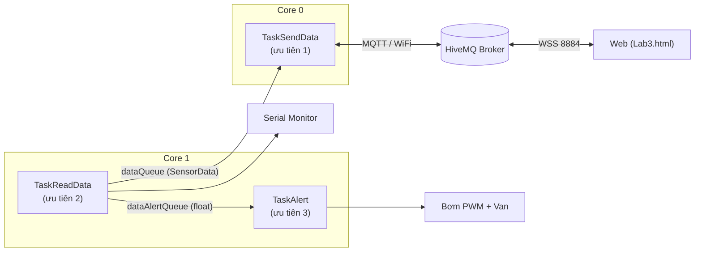

#  Hệ thống giám sát môi trường bể nuôi thủy, hải sản (ESP32 + FreeRTOS + MQTT)

Dự án mô phỏng trên **Wokwi**: ESP32 đo **mực nước** (cảm biến siêu âm HC-SR04) và **nhiệt độ bể** (DS18B20), hiển thị qua **Serial**, gửi lên **MQTT Broker** qua WiFi và hiển thị/điều khiển trên **trang Web**. Chương trình chạy trên **FreeRTOS** với 3 task phân bổ trên 2 lõi, tự động điều khiển **máy bơm nước vào** (PWM 50%/100%) và **van thoát nước ra** theo mực nước.

🔗 **Wokwi project:** https://wokwi.com/projects/480222431350092801

---

## ✨ Tính năng

- Đo mực nước không tiếp xúc bằng HC-SR04, đo nhiệt độ bể bằng DS18B20 (1-Wire).
- Hiển thị dữ liệu qua Serial Monitor (115200 baud), chu kỳ 2 giây.
- Gửi dữ liệu JSON lên MQTT Broker **HiveMQ** (`broker.hivemq.com`).
- Web hiển thị **mực nước (m)** và **nhiệt độ (°C)** dạng số, kèm các nút **điều khiển thủ công** bơm/van.
- Kiến trúc **RTOS**: 3 task, 2 hàng đợi (queue), ghim lõi CPU.
- Điều khiển tự động theo mực nước, công suất bơm bằng **PWM**.

## 🧰 Phần cứng (mô phỏng Wokwi)

| Linh kiện | Chân ESP32 | Ghi chú |
|---|---|---|
| HC-SR04 – TRIG | GPIO13 | Ngõ ra, xung 10 µs |
| HC-SR04 – ECHO | GPIO12 | Ngõ vào |
| DS18B20 – DQ | GPIO19 | 1-Wire, kéo lên 3V3 qua 4,7 kΩ |
| LED xanh dương (Bơm) | GPIO26 | PWM 5 kHz, 8 bit |
| LED đỏ (Van thoát) | GPIO25 | Mức cao = mở van |

> Trong mô phỏng, máy bơm và van được thay bằng LED. Độ sáng LED xanh thể hiện công suất bơm.

## 🏗️ Kiến trúc hệ thống



| Task | Core | Ưu tiên | Nhiệm vụ |
|---|---|---|---|
| `TaskSendData` | 0 | 1 | Kết nối WiFi, MQTT; lấy `dataQueue` gửi lên Broker; nhận lệnh thủ công |
| `TaskReadData` | 1 | 2 | Đọc HC-SR04, DS18B20; in Serial; đẩy dữ liệu vào 2 queue |
| `TaskAlert` | 1 | 3 | Lấy mực nước từ `dataAlertQueue`; điều khiển bơm và van |

## 📡 MQTT

- **Broker:** `broker.hivemq.com` – ESP32 dùng TCP cổng `1883`, Web dùng WebSocket bảo mật `wss://broker.hivemq.com:8884/mqtt`.

| Topic | Hướng | Nội dung |
|---|---|---|
| `aquaculture/sensors/data` | ESP32 → Web | `{"water_level":1.25,"temperature":26.50}` (mét, °C) |
| `aquaculture/control/pump` | Web → ESP32 | `ON_50` / `ON_100` / `OFF` |
| `aquaculture/control/valve` | Web → ESP32 | `ON` / `OFF` |

> ⚠️ HiveMQ public broker không có xác thực, ai biết tên topic đều đọc/ghi được. Nên đổi tên topic cho riêng mình hoặc dùng broker riêng khi triển khai thực tế.

## 🌊 Thuật toán điều khiển

Mực nước được tính: `water_level = 2,5 − khoảng_cách` (bể cao 2,5 m).

| Mực nước | Hành động | Thời gian |
|---|---|---|
| `< 0,5 m` | Mở van thoát | 10 s |
| `0,5 – 1 m` | Không tác động | – |
| `1 – 1,5 m` | Bơm 50% (PWM 127) | 10 s |
| `1,5 – 2 m` | Bơm 100% (PWM 255) | 20 s |
| `> 2 m` | Không tác động | – |

## 🚀 Cách chạy

### Cách 1: Chạy trên Wokwi (khuyến nghị)

1. Mở link Wokwi ở đầu trang và bấm **Start the simulation**.
2. Mở **Serial Monitor** để xem dữ liệu `[Đọc] Mực nước … | Nhiệt độ …`.
3. Mở `Lab3.html` bằng trình duyệt (cần Internet) để xem dữ liệu và điều khiển.
4. Kéo thanh trượt khoảng cách trên HC-SR04 để thử từng vùng mực nước:

| Mực nước muốn thử | Khoảng cách đặt (cm) |
|---|---|
| 0,3 m | 220 |
| 1,2 m | 130 |
| 1,8 m | 70 |

### Cách 2: Nạp lên ESP32 thật

- Cần **Arduino-ESP32 core 3.x** (dùng `ledcAttach()`).
- Thư viện: `PubSubClient`, `OneWire`, `DallasTemperature`.
- Đổi `ssid`, `password` trong code sang WiFi thật; chân ECHO của HC-SR04 xuất 5 V nên cần **cầu phân áp** hoặc module chuyển mức xuống 3,3 V.

## 📁 Cấu trúc thư mục

```
.
├── sketch.ino        # Code ESP32 (FreeRTOS + MQTT)
├── Lab3.html         # Giao diện Web (MQTT.js)
├── diagram.json      # Sơ đồ mạch Wokwi
├── libraries.txt     # Thư viện Wokwi
└── README.md
```

## ⚠️ Hạn chế đã biết

- `TaskAlert` mất 10–20 s cho mỗi lần xử lý trong khi dữ liệu đến mỗi 2 s; queue `dataAlert` có thể đầy và làm `TaskReadData` bị chặn (do `xQueueSend` dùng `portMAX_DELAY`).
- Khi `pulseIn` hết thời gian chờ (`duration = 0`), mực nước bị tính nhầm thành 2,5 m.
- Lệnh thủ công và điều khiển tự động cùng ghi vào PWM/van, không có cờ chế độ AUTO/MANUAL nên có thể ghi đè lẫn nhau.
- Web chưa có biểu đồ thời gian thực và không hiển thị trạng thái phản hồi của bơm/van.

## 🔭 Hướng phát triển

- Thêm biểu đồ thời gian thực (Chart.js) cho mực nước và nhiệt độ.
- Thêm chế độ AUTO/MANUAL, gửi trạng thái bơm/van về Web.
- Dùng broker riêng có xác thực + TLS; lưu dữ liệu vào cơ sở dữ liệu (InfluxDB/Grafana).
- Dùng cảm biến siêu âm chống nước (JSN-SR04T) cho môi trường thực tế.

## 👤 Tác giả

**Dương Cảnh Thái** – Lớp học phần N01
